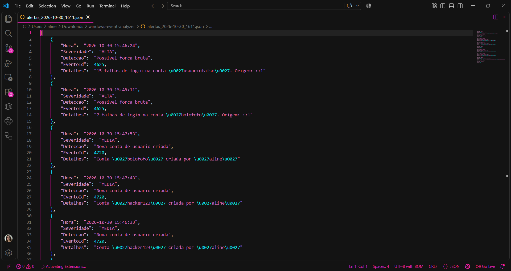

# Windows Event Log Analyzer

PowerShell script that reads the Windows Security log, detects signs of attack and correlates events to spot persistence, exporting the alerts as JSON.



## The problem

Windows records almost everything that happens on a machine in the Security log: failed logins, new accounts, group changes. But the log holds thousands of events, and an attack is just a few lines lost among them. Reading it by hand in Event Viewer is slow and easy to get wrong.

## The solution

A script that does the first pass a SOC analyst would do:

1. Pulls only the relevant events from the Security log, within a time window
2. Reads each event's fields from its XML (language-independent)
3. Applies detection rules and assigns a severity
4. Correlates events to find attack patterns that look normal in isolation
5. Prints a table and exports a JSON file for other tools (like a dashboard) to consume

The script is **read-only**: it never changes the machine or the log.

## Detections

| Event ID | Detection | Severity | Type |
|---|---|---|---|
| 4625 | Possible brute force (N failed logins on the same account) | ALTA | Threshold |
| 4720 | New user account created | MEDIA | Single event |
| 1102 | Security log cleared | CRITICA | Single event |
| 4732 | User added to the Administrators group | CRITICA | Filtered event |
| 4720 + 4732 | **Possible persistence**: account created and made admin within 10 minutes | CRITICA | **Correlation** |

## How to run

Open **PowerShell as Administrator**, go to the project folder and run:

```powershell
Set-ExecutionPolicy -Scope Process Bypass
.\analisador.ps1
```

Optional parameters:

```powershell
.\analisador.ps1 -Horas 72          # analyze the last 72 hours (default: 24)
.\analisador.ps1 -LimiteFalhas 10   # brute force threshold (default: 5)
```

The alerts are saved as `alertas_<date>.json` in the same folder.

**Requirements:** Windows 10/11, Windows PowerShell 5.1, administrator rights, and auditing enabled for Logon, User Account Management and Security Group Management. To enable it:

```powershell
auditpol /set /subcategory:"{0CCE9215-69AE-11D9-BED3-505054503030}" /success:enable /failure:enable
auditpol /set /subcategory:"{0CCE9235-69AE-11D9-BED3-505054503030}" /success:enable /failure:enable
auditpol /set /subcategory:"{0CCE9237-69AE-11D9-BED3-505054503030}" /success:enable /failure:enable
```

GUIDs are used instead of subcategory names because the names are translated on non-English Windows.

## Testing with a simulated attack

I tested the script on my own machine by simulating a small attack chain:

1. **Brute force:** 5 failed logins against a non-existent account (so no real account could get locked)
2. **Account creation:** created a local account called `hacker123`
3. **Privilege escalation:** added `hacker123` to the Administrators group
4. **Cleanup:** deleted the account, like an attacker covering their tracks

The analyzer raised 5 alerts, including the correlation: *account 'hacker123' created and added to Administrators in 0.1 minutes*.

## What I learned

- **Parse the XML, not the message.** Event messages are translated into the system language. The XML fields (`TargetUserName`, `MemberSid`, `TargetSid`) are always the same.
- **Read the field documentation carefully.** In event 4732, `TargetUserName` is the *group*, not the user who was added. The new member is in `MemberSid`.
- **Filter to avoid false positives.** Event 4732 fires for *any* security group. Without filtering by the Administrators group SID (`S-1-5-32-544`), adding someone to the regular Users group would raise a fake "added to Administrators" alert.
- **Correlate by SID, not by name.** I created `hacker123` twice during testing. Each time it received a different SID, and only the second one became admin. Matching by name would have mixed the two accounts up.
- **Deleted accounts only leave a SID behind.** Once the account is gone, Windows can't translate its SID back to a name. An analyst links the two by finding the same SID in the creation event (4720).
- **Single events are noise, sequences are signals.** An admin creating an account is normal. An account being created and made admin seconds later is what persistence looks like.

## Roadmap

- [ ] Time-window brute force (N failures within X minutes, instead of the whole period)
- [ ] More detections: new service installed (7045), scheduled task created (4698), RDP logins (4624 type 10)
- [ ] Map each detection to its MITRE ATT&CK technique
- [ ] Web dashboard consuming the JSON output, together with the [Windows Security Auditor](https://github.com/claraaraujodv/windows-security-auditor)

## Author

**Clara Araújo** — Software Engineering student at ICEV, studying for CompTIA Security+

GitHub: [github.com/claraaraujodv](https://github.com/claraaraujodv)  
LinkedIn: [linkedin.com/in/clara-araújo-a65a73347](https://www.linkedin.com/in/clara-ara%C3%BAjo-a65a73347/)
